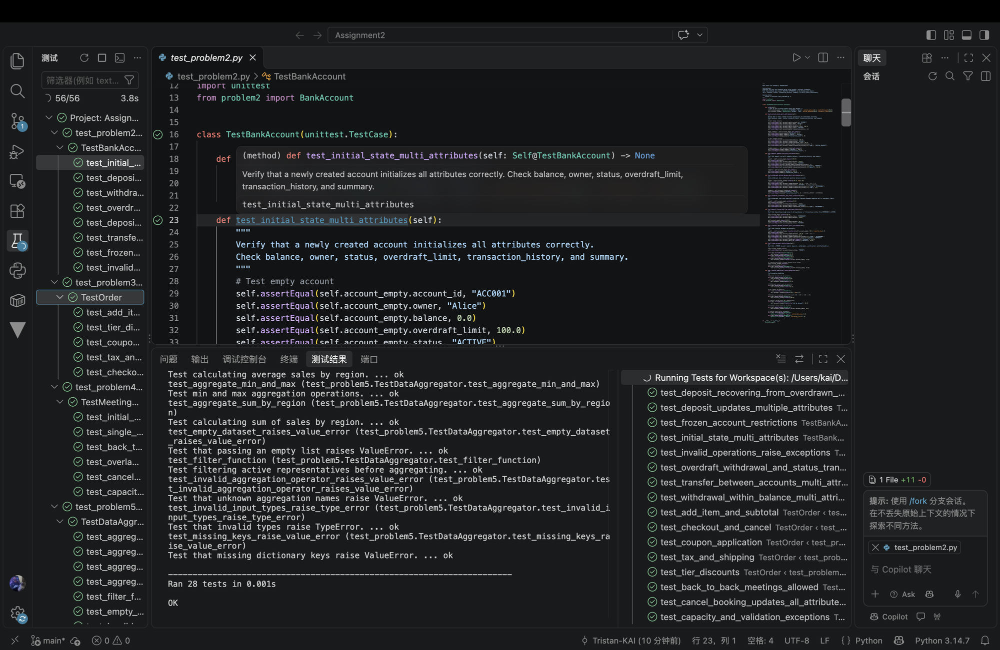

# Bug Report

This report documents the bugs discovered in the buggy programs, including the failing test cases, root cause analysis, and the applied code fixes.

---

## Bug Report 1: `min` / `max` aggregations are swapped

### 1. Program Under Test
- **File:** `problem5.py`
- **Class / Function:** `clean_and_aggregate()`

### 2. Failing Test Case
The provided test `test_aggregate_min_and_max` (in `test_problem5.py`) exposed the bug:

```python
def test_aggregate_min_and_max(self):
    min_result = clean_and_aggregate(self.sample_sales, group_by="region", metric="sales", aggregation="min")
    max_result = clean_and_aggregate(self.sample_sales, group_by="region", metric="sales", aggregation="max")
    self.assertAlmostEqual(min_result["North"], 100.0)
    self.assertAlmostEqual(max_result["North"], 200.0)
```

**Test Output / Error Message:**
```text
AssertionError: 200.0 != 100.0 within 7 places (100.0 difference)
```

### 3. Root Cause Analysis
- **Expected Behavior:** `min` should return the smallest value in each group (North min = 100.0) and `max` the largest (North max = 200.0).
- **Actual Behavior:** `min` returned `max(values)` and `max` returned `min(values)`, so the two aggregations produced the opposite results.
- **Root Cause:** The two branch bodies in the aggregation dispatch were accidentally swapped in the starter code.

### 4. Code Fix & Diff
```diff
-        elif agg_op == "min":
-            val = max(values)
-        elif agg_op == "max":
-            val = min(values)
+        elif agg_op == "min":
+            val = min(values)
+        elif agg_op == "max":
+            val = max(values)
```

---

## Bug Report 2: Empty input list does not raise `ValueError`

### 1. Program Under Test
- **File:** `problem5.py`
- **Class / Function:** `clean_and_aggregate()`

### 2. Failing Test Case
The provided test `test_empty_dataset_raises_value_error` (in `test_problem5.py`) exposed the bug:

```python
def test_empty_dataset_raises_value_error(self):
    with self.assertRaises(ValueError):
        clean_and_aggregate([], group_by="region", metric="sales")
```

**Test Output / Error Message:**
```text
AssertionError: ValueError not raised
```

### 3. Root Cause Analysis
- **Expected Behavior:** Passing an empty `records` list should raise `ValueError` (as stated in the function docstring).
- **Actual Behavior:** The function silently returned an empty dictionary `{}` because there was no validation of the input list length.
- **Root Cause:** A missing input-validation guard for empty records.

### 4. Code Fix & Diff
```diff
+    if not records:
+        raise ValueError("records cannot be empty")
+
     # Group data
     grouped_values: Dict[str, List[float]] = {}
```

---

## Bug Report 3: Back-to-back bookings are incorrectly rejected as conflicts

### 1. Program Under Test
- **File:** `problem4.py`
- **Class / Function:** `MeetingRoom.book()`

### 2. Failing Test Case
The test `test_back_to_back_meetings_allowed` (in `test_problem4.py`) exposed the bug:

```python
def test_back_to_back_meetings_allowed(self):
    self.assertTrue(self.room.book("B01", "Meeting 1", 9, 10, 5))
    self.assertTrue(self.room.book("B02", "Meeting 2", 10, 12, 5))  # raised ValueError
```

**Test Output / Error Message:**
```text
ValueError: Time slot [10, 12] conflicts with booking 'B01' [9, 10]
```

### 3. Root Cause Analysis
- **Expected Behavior:** Per the spec, "Back-to-back meetings (e.g. 9-10 and 10-11) do NOT conflict and are allowed." A new booking whose `start_time` equals an existing booking's `end_time` should be permitted.
- **Actual Behavior:** The overlap check treated touching intervals as overlapping, rejecting a booking that started exactly when the previous one ended.
- **Root Cause:** The conflict condition used strict inequalities (`end_time < b["start_time"] or start_time > b["end_time"]`). At the boundary `start_time == b["end_time"]`, `start_time > b["end_time"]` is `False`, so the `not (...)` wrapper evaluated to `True` (i.e. conflict). The comparison operators were too strict for touching intervals.

### 4. Code Fix & Diff
```diff
-        for b in self.bookings:
-            if not (end_time < b["start_time"] or start_time > b["end_time"]):
+        for b in self.bookings:
+            if start_time < b["end_time"] and end_time > b["start_time"]:
                 raise ValueError(...)
```

---

## Summary

| # | File | Bug | Fix |
|---|------|-----|-----|
| 1 | `problem5.py` | `min`/`max` branches swapped | Use `min()` for min and `max()` for max |
| 2 | `problem5.py` | Empty list returned `{}` instead of raising | Add `if not records: raise ValueError(...)` |
| 3 | `problem4.py` | Back-to-back bookings rejected as conflicts | Use inclusive overlap check `start < b.end and end > b.start` |

After applying the fixes, all test suites pass: `test_problem2.py` (8 tests), `test_problem3.py` (5 tests), `test_problem4.py` (6 tests), `test_problem5.py` (9 tests), and `problem1.py` (10 doctests).

---

## Test Runs from VSCode

All tests pass in VSCode's Testing panel (green checkmarks, `Ran 28 tests ... OK`):


